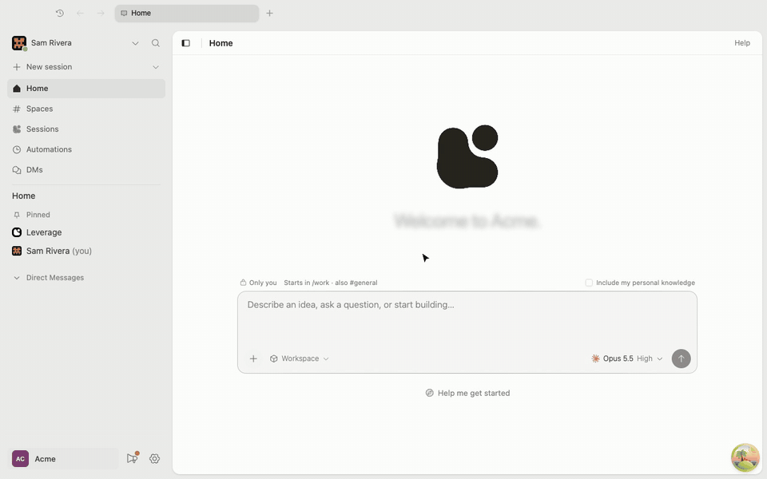

# <picture><source media="(prefers-color-scheme: dark)" srcset="docs/leverage-dark.svg"></picture> Codex on Leverage

<a href="https://leverage.computer/integrations/#codex"></a>
<a href="#features"></a>

[Features](#features) · [Desktop](#desktop) · [Terminal](#terminal) ·
[leverage.computer](https://leverage.computer)

[](docs/desktop.mp4)

## Features

- **Multiplayer harness**: each prompt shows who sent it, and a teammate's
  prompt appears as soon as they send it.
- **Company computer**: sessions run in Leverage's sandbox and are shared with
  your team. Leverage hosts the SSH server, `ssh.leverage.computer`, so you
  don't run one.
- **Steering**: your prompt shows at once and steers a running turn. Prompts
  sent while it is busy wait in a queue you can list, take back or send now.
- **Governance**: the agent asks you to pick an option, approve a plan, or
  allow a call: once, for the session, or always.

Spaces show as projects, sessions as threads.

## Desktop

In the Leverage desktop app, open Settings → Developer tools and click
**Sync into Codex**.

From a terminal instead:

```sh
leverage login
leverage ssh setup
leverage codex setup

# add another workspace
leverage codex setup --workspace <slug>

# after spaces change; quit Codex first
leverage codex refresh

# when you lose a device
leverage ssh forget <fingerprint>
```

## Terminal

```sh
leverage codex engineering
```

Opens the Codex CLI on the space `engineering`.

[](docs/terminal.mp4)

## The Leverage CLI

The terminal commands need the Leverage CLI. In the Leverage app, Settings →
Developer tools → CLI gives its install command, for macOS and Linux.

A session you start from Codex is private until you share it.
